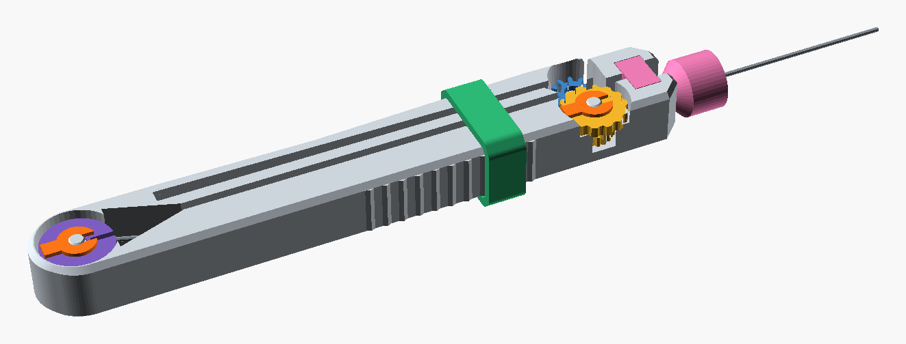
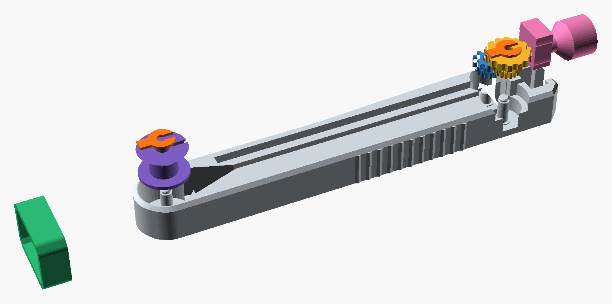

# Solder Pen

A one-handed solder-wire pen: roll a thumbwheel and fine solder feeds straight out of a standard blunt Luer
needle, right where the iron is. Roll it back to retract. Fully parametric OpenSCAD, printed in PETG.

- **Lay the wire in, don't thread it.** It runs in an open groove from a bobbin inside the body to the nose.
  Slide the ring back and the rollers open; slide it forward and they bite.
- **The body is the spring.** A slit splits off a long arm that carries one roller; the ring bends it in,
  clicking through detents from a light touch to ~11 N.
- **Both rollers drive.** Knurled rims grip the wire; gears under them mesh, and a thumb rim pokes out of the side.
- **A real Luer-lock nose.** Standard 6 % taper and lock thread, so a blunt dispensing needle screws on.

## Assembly

Eight printed parts, no hardware. **[Assembly guide](docs/assembly.md)**: assemble, load solder, use, refill,
and every fit's clearance.

## Status

Early prototype (2026-11). Current design: **concept C "stick"**, a flat 16 × 11 pen with a bobbin inside, an
open wire groove, a body-flexure pinch set by a sliding ring, a driven gear pair and a real Luer-lock nose. Ready to
print. Concepts A and B and their rigs are history. See [docs/status.md](docs/status.md).

| | |
|---|---|
| [docs/design.md](docs/design.md) | Concept C and the earlier concepts and rigs, every part, print settings |
| [docs/assembly.md](docs/assembly.md) | Step-by-step assembly and the fits table |
| [docs/decisions.md](docs/decisions.md) | Why it's built this way; rejected ideas |
| [docs/status.md](docs/status.md) | Where it is, what's next, measurements |

Ready-to-slice files are in [`stl/`](stl/). Rebuild everything with `./stl/export.sh`, `./renders/render.sh`
and `./checks/run.sh` (OpenSCAD, Python 3 with Pillow, `rsvg-convert`).
