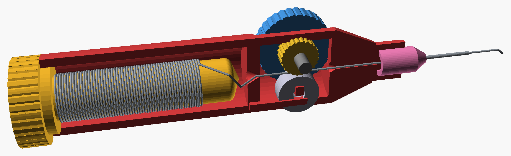
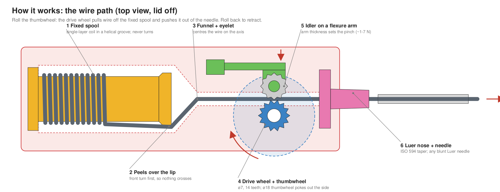
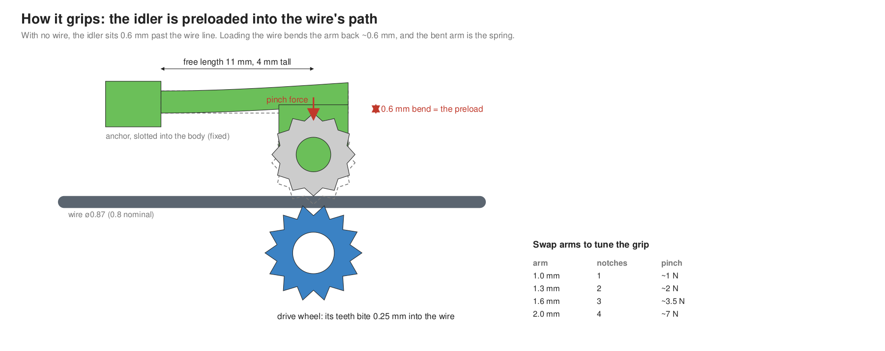
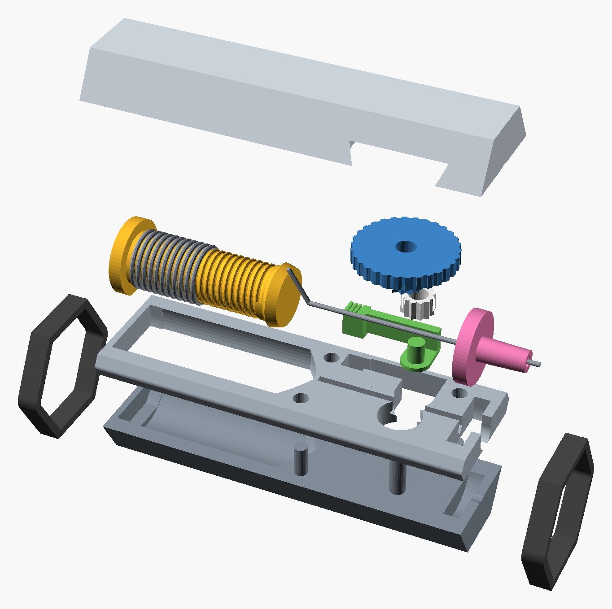

# Solder Pen

A one-handed solder-wire pen: roll a thumbwheel and fine solder feeds straight out of a standard blunt Luer
needle, right where the iron is. Roll it back to retract. Fully parametric OpenSCAD, printed in PETG.

- **The coil never turns.** Solder sits in a helical groove on a fixed spool, one layer deep, so it can't
  tangle, stack or dig in. The drive always peels the front turn.
- **Pull, don't push.** A thumbwheel-driven toothed wheel pinches the wire against an idler and pulls it off
  the spool. Only the last ~15 mm, from the wheel to the tip, is pushed.
- **Centred needle.** The wire runs dead straight on the pen's axis through an ISO 594 Luer taper, so any
  blunt dispensing needle fits.
- **Tunable grip.** The idler rides on a printed flexure arm. Swap arms (1.0–2.0 mm) to set the pinch from ~1 to ~7 N.

## How it works

## Assembly

The pen-scale test rig is a hex body in three flat layers that print without supports; every part drops in
from above in order. **[Assembly guide](docs/assembly.md)**: eight steps and every fit's clearance.

## Status

Early prototype (2026-11). Pen-scale rig v2 is ready to print. See [docs/status.md](docs/status.md).

| | |
|---|---|
| [docs/design.md](docs/design.md) | Concepts A and B, the test rigs, every part, print settings |
| [docs/assembly.md](docs/assembly.md) | Step-by-step assembly and the fits table |
| [docs/decisions.md](docs/decisions.md) | Why it's built this way; rejected ideas |
| [docs/status.md](docs/status.md) | Where it is, what's next, measurements |

Ready-to-slice files are in [`stl/`](stl/). Rebuild everything with `./stl/export.sh`, `./renders/render.sh`
and `./checks/run.sh` (OpenSCAD, Python 3 with Pillow, `rsvg-convert`).
