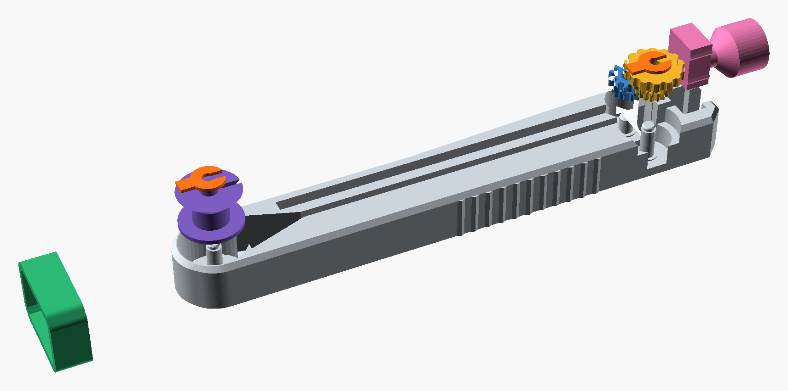
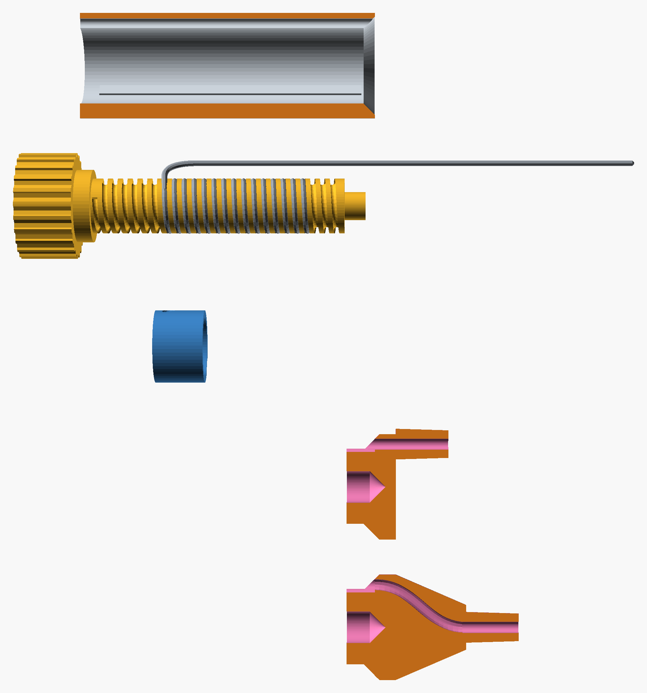
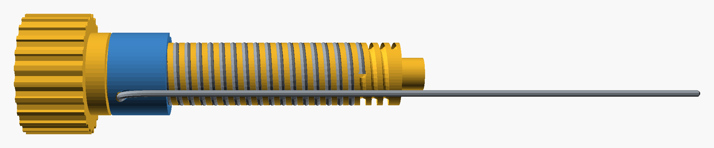
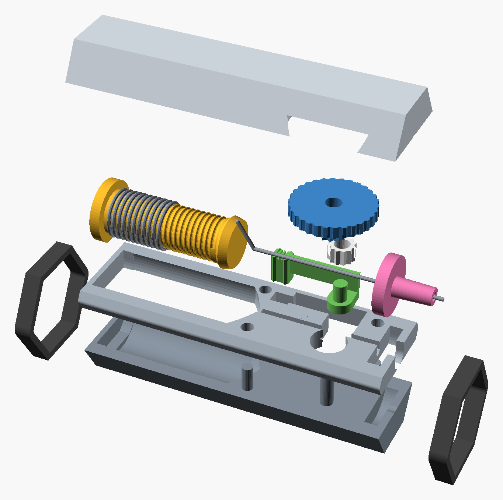
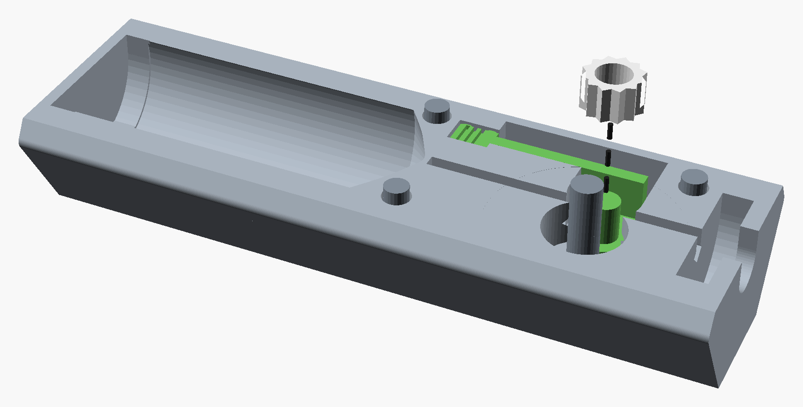
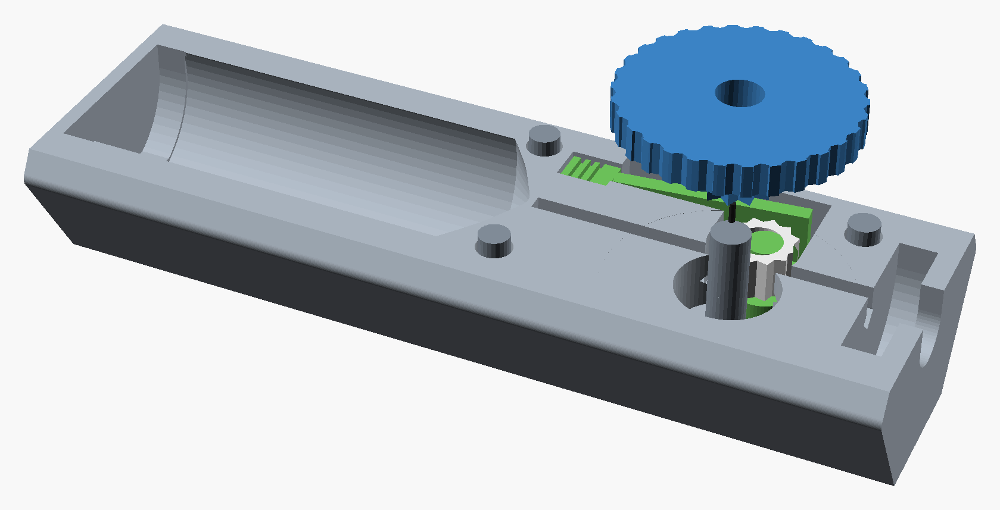
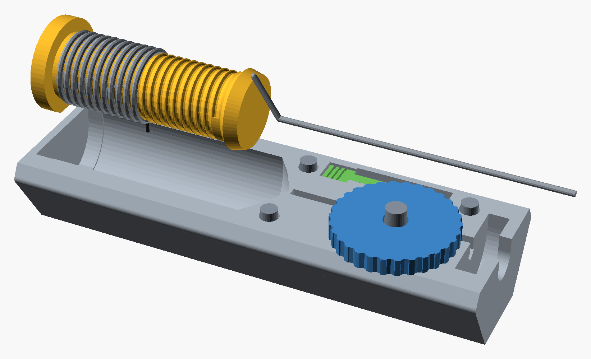

# Concept C "stick": assemble, load, use, refill

Eight printed parts (two are the same clip), the user's blunt Luer-lock needle, and the solder. No screws, no glue.

| Part | Colour | What it is |
|---|---|---|
| `body` | grey | The whole frame, one print: bobbin window at the back, open wire groove, the **arm** (the long strip split off by the slit), gear pocket, nose pocket. The ridges on one edge are the ring's detents. |
| `bobbin` | purple | The solder spool. A slot in its core takes the wire's tail. |
| `gear_fixed` | yellow | Knurl (grips the wire) + spur gear + **thumb rim** (sticks out of the side). |
| `gear_arm` | blue | Knurl + spur gear, on the arm. Driven by the fixed gear, so both sides grip. |
| `ring` | green | Slides along the body. Forward = pinch on (clicks through detents), back = open. |
| `clip` ×2 | orange | Snap onto the bobbin's peg and the fixed gear's peg. |
| `nose` | pink | Drops into the front pocket. A **male Luer-lock**: 6 % taper inside a collar with the standard double-start thread; the needle screws on. |

## Assemble (once)

1. Slide the **ring** onto the body from the back end (the round end), ridges side matching its bump, and push
   it to just behind the ridges. Here it doesn't touch the arm, so the knurls stand open (1.6 mm).
2. Drop the **arm gear** on its peg (the short one, on the arm). Then the **fixed gear** on the tall peg, rim up:
   turn it until the spur teeth mesh, and it drops. Its rim now overlaps the arm gear, which keeps it in.
3. Snap a **clip** onto the fixed gear's peg (push it sideways by the tab into the neck above the rim).
4. Press the **nose** into its pocket, collar out through the front slot. Crush ribs hold it.

## Load solder

1. **Wind the bobbin in your hand.** Bend the first 3 mm of the solder at 90° and push it into the slot in the
   bobbin's core. Wind ~20 turns (about 0.5 m) onto it, neatly, then cut the solder ~10 cm past the bobbin.
2. **Ring back** (behind the ridges): the knurls open.
3. Drop the **bobbin** on its peg and snap the second **clip** on.
4. **Lay the wire in.** From the bobbin, through the funnel, into the open groove, between the two knurls,
   to the nose. Nothing to thread except the nose: pull the nose up out of its pocket, push the wire through
   its bore (a straight 18 mm hole printed upright), push the nose back in.
5. **Ring forward** until it clicks into a detent. The arm swings in and the knurls bite the wire.
6. **Needle on:** push the wire end into the needle's hub, then push the hub onto the taper and turn it a
   quarter-turn clockwise to lock it.

## Use

Roll the **thumb rim** (it sticks out of the ridged side): one way feeds wire out of the needle, the other pulls
it back. If it slips, click the ring one detent further forward; if it's stiff or flattens the wire, back one.

## Refill

Ring back, pop the bobbin's clip, lift the bobbin off, wind it (or a spare), and do *Load solder* 3–5 again.
The gears, nose and needle stay put.

## Fits

| Fit | Clearance | Risk |
|---|---|---|
| Gears and bobbin on ø3 pegs | ø3.5 bores (0.5 diametral) | Bind: drill to 3.5 |
| Gears in their pocket | 0.4 radial; 0.3 between layers | |
| Spur gears (12 teeth, module 0.63) | 0.15 backlash at the pinched centre distance; clear through a full tooth (`fits_clear`) | |
| Knurl gap at rest | 1.6 mm (wire 0.87) | |
| Knurl bite when pinched | 0.15 each side (sets the gears' centre distance, 7.57) | |
| Ring over the body | 0.15; slides on from the back clear (`fits_clear`) | Tight: sand the ring's inside |
| Ring's pinch at its detents | 0, 0, 0.3, 0.7, 1.1, 1.8, 2.7, 4.1, 6.5, 10.9 N (`pinch_ring`, beam model) | Weak grip: use a later detent |
| Clips on the peg necks | ø2.2 neck, mouth 1.8 | Snaps off: reprint (two on the plate) |
| Nose block in its pocket | 0.15 a side, crush ribs 0.2 proud (0.05 bite) | |
| Luer-lock collar thread | ISO minor 7.0 / major 8.0, +0.3 for print | Needle won't screw in: it still holds on the taper |

---

# Concept A test pen (retired 2026-11-24)

Superseded by concept C below the fold; kept for the record. Its loading was unworkable (see decisions.md).

Five printed parts and ~0.45 m of 0.8 mm solder, plus a blunt Luer needle. No screws or glue.

| Part | Qty | Colour | What it is |
|---|---|---|---|
| `barrel` | 1 | grey | ø15 tube. A **key rib** runs down the inside; the **wire channel** is a slot in the wall opposite it. |
| `core` | 1 | yellow | Knob, journal, grooved lead screw, front pin: one part. The solder lives in its groove. |
| `nut` | 1 | blue | Ring with a notch for the key rib, a small tooth for the groove, and a tunnel the wire leaves through. |
| `nose_straight` | 1 | pink | Front cap, needle off-centre, in line with the channel. Try this one first. |
| `nose_s` | 1 | pink | Same, but an S-bend centres the needle. Swap it in later to see what the bend costs. |

**How it works:** the nut can't turn (key rib), so turning the core makes it walk along the screw. The wire is
wound in the groove in front of the nut; each turn the nut advances, it frees one more turn of wire, which
leaves the groove through the nut's tunnel, along the barrel's channel, and out of the nose and needle.
Turn the other way and the wire is wound back in.

## Known problem: the nut cannot get onto the core as printed

The checks proved the fits only at the finished positions, not the way in. Swept along its screw path the nut
jams after ~4.7 mm: the groove ends 0.8 mm short of the core's front face, and the journal closes it at the back,
so the tooth has nowhere to enter. **The core needs its groove run out through the front face**; then step 2
works. Don't force it on: you'll snap the tooth.

## Steps

**1. Check by hand.** The core must spin freely in the barrel. The nose spigot should push into the barrel's
front with its notch over the key rib: a firm push, not a hammer.

**2. Nut onto the bare core.** Nothing on it yet: the groove is empty. Slide the nut over the core's **front** end
and *screw* it on (the tooth rides the groove; turn it as it goes). Park it at the **back**, against the journal.

**3. Push the wire in through the nut; it fills the groove itself.**

1. Straighten the **end** of the solder, still on its reel or length, and cut it square.
2. Find the small hole in the nut's *outside* wall near its front edge. Push the end **in** there. The tunnel
   turns it round, and it comes out of the nut's inner mouth already pointing **along the groove**, in the
   winding direction. That is the same path the wire takes out when you use the pen, just run backwards.
3. Keep pushing gently. The wire runs along the groove under the nut (the nut's ring covers the first ~5
   turns), then comes out of the nut's front edge. From there, **coax it round with a fingertip**, pressing it into
   the groove, one turn per groove, until the tip reaches the small round **anchor hole** near the front of the
   groove (the notch in the picture, ~3 turns before the groove ends). About 0.45 m goes in (~20 turns).
4. Push the last ~4 mm of the tip into the anchor hole and bend it over.
5. Cut the solder ~6 cm outside the nut. That end goes down the barrel and out of the needle.

If the wire won't follow the groove, back it out and re-straighten it: a kinked end rides up over the ridge.

**4. Core and nut into the barrel.** Slide them in from the **front**, knob last. Put the nut's notch over the
key rib and the wire end into the barrel's channel slot. The knob stops against the barrel's back face.

**5. Nose.** Thread the wire end through the nose's channel hole, then push the spigot in: notch over the key
rib, the core's front pin into its socket. Trim the wire at the Luer taper.

**6. Needle.** Push the blunt needle onto the Luer taper with a twist.

**7. Feed.** Turn the knob **counter-clockwise seen from the knob end**. The nut should creep forward and wire
come out of the needle; reverse to pull it back. If it goes the wrong way round, that's a model bug, not you.

## What to look for (the point of this print)

- Does the wire come out steadily, and go back in when reversed?
- Is it any worse through the S nose than the straight one?
- Does the nut peel the wire cleanly, without the coil loosening on the core?

---

# Assembling the pen-scale rig (v2, retired)

The rig is pen B's real insides at real size, in a hex body (20 mm across flats) made of three flat layers.
Everything goes in **straight down from above**, in order; the two rings slide on from the ends.
`./checks/run.sh` proves this order works (`assembly_paths_clear`: each part's path is swept and must not pass
through anything already in place) and that no layer prints with a ceiling (`no_ceilings`).

| Part | Qty | Colour in the renders |
|---|---|---|
| `base` (bottom layer; drive pin and 3 pegs built in) | 1 | dark grey |
| `mid` (frame: the rollers' layer, everything cut straight through) | 1 | mid grey |
| `lid` (top layer; thumbwheel pocket opens out of the side) | 1 | light grey |
| `arm0.9` / `arm1.1` / `arm1.3` / `arm1.6` (flexure arm with the idler pin; 1–4 notches = thickness) | use 1 | green |
| `idler` (12 teeth) or `idler_smooth` (ring groove on top) | use 1 | white |
| `wheel` (ø7 drive teeth + ø18 thumbwheel, one part) | 1 | blue |
| `spool` (flange with a flat, grooved core, front lip) | 1 | yellow |
| `nose` (flange + male Luer-slip taper) | 1 | pink |
| `ring` (hex band) | 2 | black |

Plus ~0.6 m of 0.8 mm solder and a blunt Luer needle. No screws or glue.

## Steps

**1. Mid onto base.** The three pegs on the base pass through the mid's holes. The drive pin sticks up
through the round roller hole.

**2. Arm.** Pick an arm (start with **1.3**, 3 notches). Press its block down into the square slot (through the
mid into the base): the ribs on its sides crush as it goes in, so it's a firm push and then it can't wobble.
The thin flexure lies in the long slot, and the idler pin points **up**.

**3. Idler.** Drop it onto the arm's pin. The arm is printed straight with the idler 1.5 mm past where the wire
will hold it, so it now sits right where the drive wheel goes. That's intended: the 1.5 mm the wire bends it back
is the pinch.

**4. Wheel.** Push the idler back toward the side wall with a fingertip (the arm bends) and hold it there.
Drop the wheel, thumbwheel **up**, over the drive pin, and let go: the idler springs onto the drive teeth. The
thumbwheel rests above the mid with a 0.4 mm gap and must spin freely (it turns the idler too).

**5. Spool and wire.** Wind the solder on first: tail through the hole at the back of the groove, then wind
toward the lip, one turn per groove (~20 turns). Drop the spool in, flange in the back groove, flat on the flange
down. Lead the free end over the lip, down the funnel, and lay it in the slot along the axis: push the idler
arm back again with a fingertip to lay it between the rollers. Rolling the thumbwheel should now pull it through.

**6. Nose.** Thread the wire through the nose and drop its flange into the front groove, taper out.

**7. Lid.** Lower it straight down. The pegs and the top of the drive pin go into its holes, and the
thumbwheel ends up in the lid's pocket, poking out through the side. Nothing passes through the thumbwheel:
the lid has no material below it.

**8. Rings.** Slide a hex ring over each end to clamp the stack. Push a needle onto the taper.

## Fits (v2, set for FDM)

v1's fits were modelled tight with no print allowance: printed holes come out ~0.2 mm small, so pins
wouldn't go in and the parts that did go in bound. v2 uses these, all in `parts/solder_pen_rig.scad`:

| Fit | Model | Clearance | Parameter |
|---|---|---|---|
| Wheel on the drive pin | ø3.0 pin / ø3.5 bore | 0.5 on dia | `spin` |
| Idler on the arm pin | ø3.0 pin / ø3.5 bore (idler now ø6) | 0.5 on dia | `spin` |
| Drive pin top in the lid | ø3.0 / ø3.5 | 0.5 on dia | `spin` |
| Rollers between layers | drive roller 4 tall in a 4.6 layer | 0.3 each side | `ax` |
| Thumbwheel | in its pocket: 0.5 round the rim, 0.4 above and below | | `thumb_z0`, `cav_z1` |
| Pegs | ø2.5 / ø2.9 | 0.4 on dia | `peg_c` |
| Arm block in its slot | 0.15 a side, plus 2 crush ribs each side standing 0.45 proud (0.3 interference): no play | | `slot_a`, `rib` |
| Flexure in its slot | room for the thickest arm bent 1.5 + 0.6; 0.3 above and below | | `pre`, `pocket_y1` |
| Spool and nose flanges in their grooves | | 0.25 a side | `grv` |
| Rings over the body | hex band | 0.3 a side | `ring_c` |
| Wire channel | ø0.87 wire in a 2.2 diamond, 1.3 slot above it in the mid | | `chan` |

If a fit is still off, change the parameter and re-export: one number per kind of fit, so a tight pin or a
loose flange is a one-line change.

## The pinch (spring)

The arm is a cantilever: its block is locked in the body by crush ribs, the 13 mm flexure bends, and the idler's
pin stands on a 2.1 mm plate at its tip. The wire bends it 1.5 mm, giving ~1 / 1.8 / 3 / 5.6 N for the 0.9 /
1.1 / 1.3 / 1.6 arms. The only play left in the force path is the idler's bore clearance (0.25), a sixth of the
preload, so print error moves the force by ~15 %, not to zero. `pinch_holds` checks this.

v1's spring pushed almost nothing: its 0.6 mm preload was smaller than the play in its path (0.12 mm a side in a
4 mm slot let the block swivel ~0.8 mm out at the idler, plus 0.13 of bore clearance), and its idler pin stood on
a 0.8 mm plate that bent, tipping the idler away instead of pushing it at the drive.

## v1 (printed 2026-11-24, retired)

A round body split in two at the wire. It could not be assembled: the thumbwheel poked out past the body, and
the cover's wall below it had to pass straight through the thumbwheel to close. The cover's thumbwheel pocket
was also a ø19 ceiling that printed as spaghetti. Both are now checks that fail on v1.
