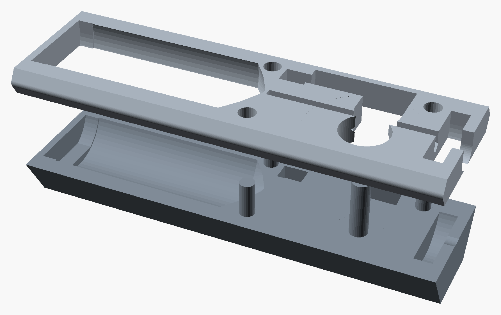
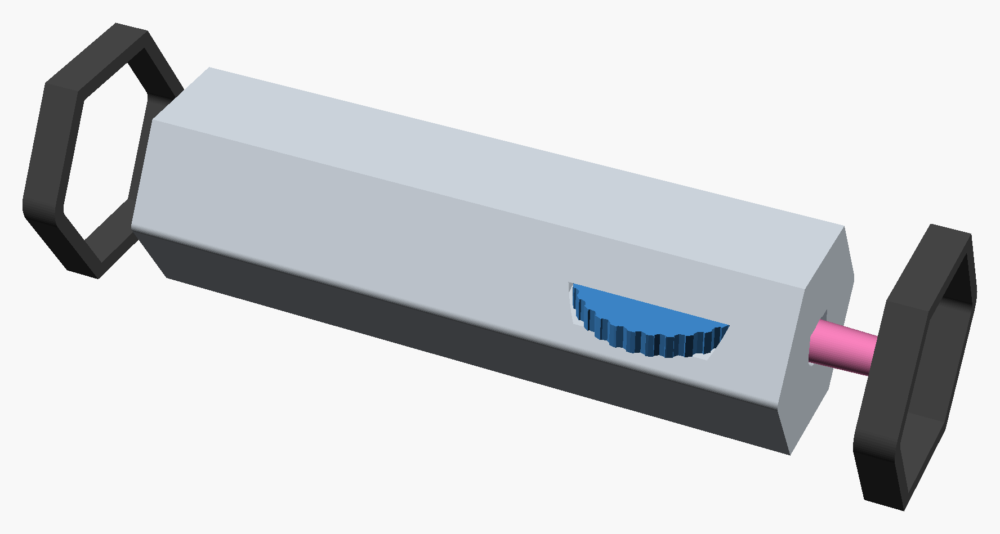

# Assembling the pen-scale rig (v2)

The rig is pen B's real insides at real size, in a hex body (20 mm across flats) made of three flat layers.
Everything goes in **straight down from above**, in order; the two rings slide on from the ends.
`./checks/run.sh` proves this order works (`assembly_paths_clear`: each part's path is swept and must not pass
through anything already in place) and that no layer prints with a ceiling (`no_ceilings`).

| Part | Qty | Colour in the renders |
|---|---|---|
| `base` (bottom layer; drive pin and 3 pegs built in) | 1 | dark grey |
| `mid` (frame: the rollers' layer, everything cut straight through) | 1 | mid grey |
| `lid` (top layer; thumbwheel pocket opens out of the side) | 1 | light grey |
| `arm0.9` / `arm1.1` / `arm1.3` / `arm1.6` (flexure arm with the idler pin; 1–4 notches = thickness) | use 1 | green |
| `idler` (12 teeth) or `idler_smooth` (ring groove on top) | use 1 | white |
| `wheel` (ø7 drive teeth + ø18 thumbwheel, one part) | 1 | blue |
| `spool` (flange with a flat, grooved core, front lip) | 1 | yellow |
| `nose` (flange + male Luer-slip taper) | 1 | pink |
| `ring` (hex band) | 2 | black |

Plus ~0.6 m of 0.8 mm solder and a blunt Luer needle. No screws or glue.

## Steps

**1. Mid onto base.** The three pegs on the base pass through the mid's holes. The drive pin sticks up
through the round roller hole.

**2. Arm.** Pick an arm (start with **1.3**, 3 notches). Press its block down into the square slot (through the
mid into the base): the ribs on its sides crush as it goes in, so it's a firm push and then it can't wobble.
The thin flexure lies in the long slot, and the idler pin points **up**.

**3. Idler.** Drop it onto the arm's pin. The arm is printed straight with the idler 1.5 mm past where the wire
will hold it, so it now sits right where the drive wheel goes. That's intended: the 1.5 mm the wire bends it back
is the pinch.

**4. Wheel.** Push the idler back toward the side wall with a fingertip (the arm bends) and hold it there.
Drop the wheel, thumbwheel **up**, over the drive pin, and let go: the idler springs onto the drive teeth. The
thumbwheel rests above the mid with a 0.4 mm gap and must spin freely (it turns the idler too).

**5. Spool and wire.** Wind the solder on first: tail through the hole at the back of the groove, then wind
toward the lip, one turn per groove (~20 turns). Drop the spool in, flange in the back groove, flat on the flange
down. Lead the free end over the lip, down the funnel, and lay it in the slot along the axis: push the idler
arm back again with a fingertip to lay it between the rollers. Rolling the thumbwheel should now pull it through.

**6. Nose.** Thread the wire through the nose and drop its flange into the front groove, taper out.

**7. Lid.** Lower it straight down. The pegs and the top of the drive pin go into its holes, and the
thumbwheel ends up in the lid's pocket, poking out through the side. Nothing passes through the thumbwheel:
the lid has no material below it.

**8. Rings.** Slide a hex ring over each end to clamp the stack. Push a needle onto the taper.

## Fits (v2, set for FDM)

v1's fits were modelled tight with no print allowance: printed holes come out ~0.2 mm small, so pins
wouldn't go in and the parts that did go in bound. v2 uses these, all in `parts/solder_pen_rig.scad`:

| Fit | Model | Clearance | Parameter |
|---|---|---|---|
| Wheel on the drive pin | ø3.0 pin / ø3.5 bore | 0.5 on dia | `spin` |
| Idler on the arm pin | ø3.0 pin / ø3.5 bore (idler now ø6) | 0.5 on dia | `spin` |
| Drive pin top in the lid | ø3.0 / ø3.5 | 0.5 on dia | `spin` |
| Rollers between layers | drive roller 4 tall in a 4.6 layer | 0.3 each side | `ax` |
| Thumbwheel | in its pocket: 0.5 round the rim, 0.4 above and below | | `thumb_z0`, `cav_z1` |
| Pegs | ø2.5 / ø2.9 | 0.4 on dia | `peg_c` |
| Arm block in its slot | 0.15 a side, plus 2 crush ribs each side standing 0.45 proud (0.3 interference): no play | | `slot_a`, `rib` |
| Flexure in its slot | room for the thickest arm bent 1.5 + 0.6; 0.3 above and below | | `pre`, `pocket_y1` |
| Spool and nose flanges in their grooves | | 0.25 a side | `grv` |
| Rings over the body | hex band | 0.3 a side | `ring_c` |
| Wire channel | ø0.87 wire in a 2.2 diamond, 1.3 slot above it in the mid | | `chan` |

If a fit is still off, change the parameter and re-export: one number per kind of fit, so a tight pin or a
loose flange is a one-line change.

## The pinch (spring)

The arm is a cantilever: its block is locked in the body by crush ribs, the 13 mm flexure bends, and the idler's
pin stands on a 2.1 mm plate at its tip. The wire bends it 1.5 mm, giving ~1 / 1.8 / 3 / 5.6 N for the 0.9 /
1.1 / 1.3 / 1.6 arms. The only play left in the force path is the idler's bore clearance (0.25), a sixth of the
preload, so print error moves the force by ~15 %, not to zero. `pinch_holds` checks this.

v1's spring pushed almost nothing: its 0.6 mm preload was smaller than the play in its path (0.12 mm a side in a
4 mm slot let the block swivel ~0.8 mm out at the idler, plus 0.13 of bore clearance), and its idler pin stood on
a 0.8 mm plate that bent, tipping the idler away instead of pushing it at the drive.

## v1 (printed 2026-11-24, retired)

A round body split in two at the wire. It could not be assembled: the thumbwheel poked out past the body, and
the cover's wall below it had to pass straight through the thumbwheel to close. The cover's thumbwheel pocket
was also a ø19 ceiling that printed as spaghetti. Both are now checks that fail on v1.
