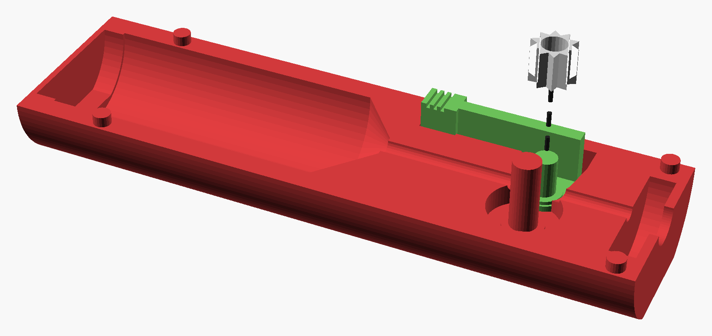
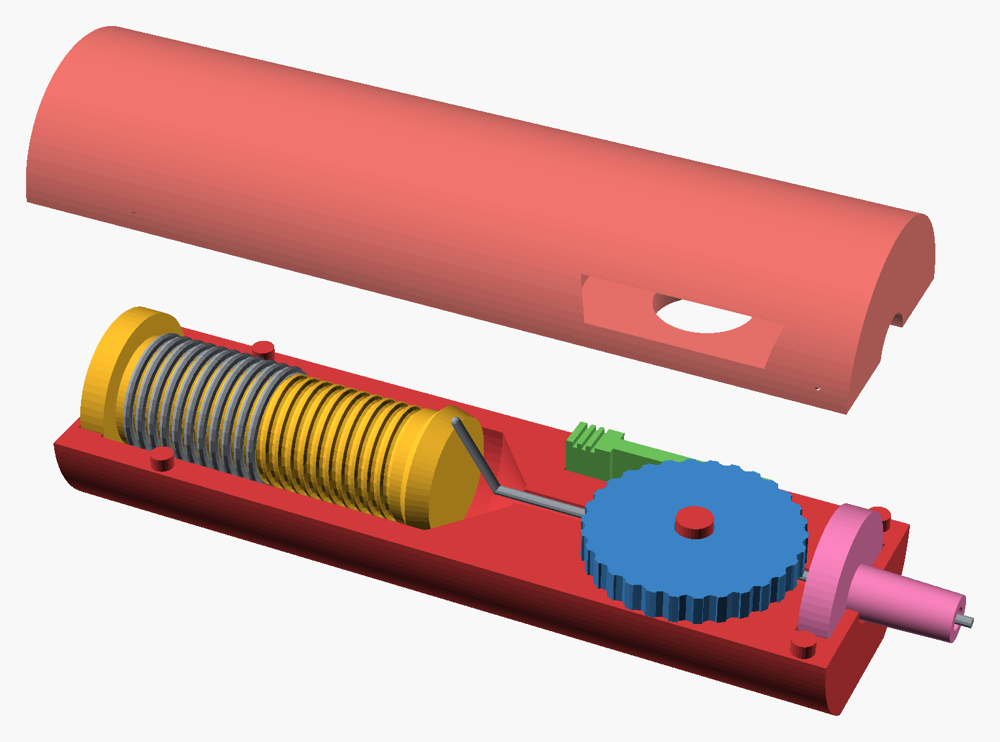
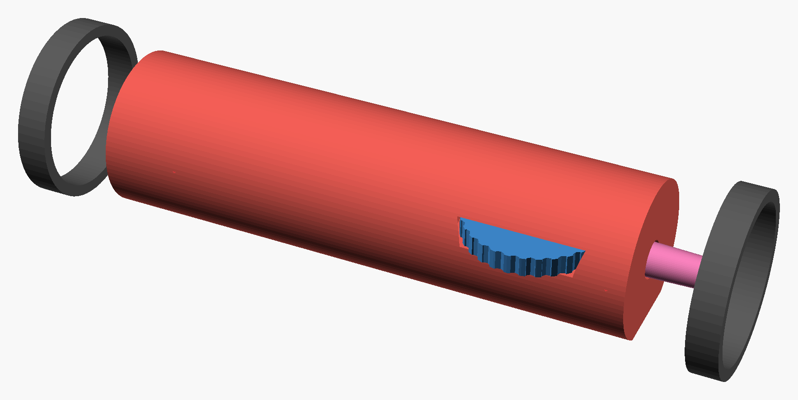

# Assembling the pen-scale rig

The rig is pen B's real insides at real size in a ø20 body split along the wire. Parts:

| Part | Qty | Colour in the renders |
|---|---|---|
| `bottom` (flat underside, drive pin and 4 pegs built in) | 1 | red |
| `cover` (thumbwheel window, pin socket, 4 peg holes) | 1 | light red |
| `arm0.9` / `arm1.2` / `arm1.5` / `arm1.8` (flexure arm with the idler pin; 1–4 notches = thickness) | use 1 | green |
| `idler` (10 teeth) or `idler_smooth` (recess on top) | use 1 | grey |
| `wheel` (ø7 drive teeth + ø18 thumbwheel, one part) | 1 | blue |
| `spool` (flange with a flat, grooved core, front lip) | 1 | yellow |
| `nose` (flange + male Luer-slip taper) | 1 | pink |
| `ring` | 2 | dark grey |

Plus ~0.65 m of 0.8 mm solder and a blunt Luer needle.

## Steps

Everything drops in **from above into the bottom half**, in this order. The order matters: the thumbwheel
covers the idler, so the arm and idler must go in before the wheel.

**1. Arm.** Pick an arm (start with **1.5**, 3 notches). Its square anchor block drops into the square slot
behind the drive pin; the thin flexure lies in the long pocket along the side; the idler pin points **up**.
The anchor is meant to be a snug push fit (0.12 mm a side).

**2. Idler.** Slide the idler onto the arm's pin. With no wire, its teeth reach 0.6 mm past the wire's line
(that's the preload): the wire will push it, and the arm, back.

**3. Wheel.** Thumbwheel **up**, drive teeth down. Drop it over the drive pin. The thumbwheel overhangs the
idler with 0.4 mm to spare, and must spin freely.

**4. Spool and wire.** Wind the solder onto the spool first: tail through the hole at the back of the groove,
then wind toward the lip, one turn per groove (~21 turns). Drop the spool in with its flange in the back
groove (the flat on the flange goes down). Lead the free end over the lip, down the funnel, into the channel,
and push the idler arm aside to lay it between the rollers. Rolling the thumbwheel should now pull it through.

**5. Nose.** Thread the wire through the nose and drop its flange into the groove at the front, taper pointing
out.

**6. Cover.** Lay the cover on: the four pegs locate it, the drive pin's top enters the socket in the cover,
and the thumbwheel pokes out through the window on the side.

**7. Rings.** Slide a ring over each end to hold the halves (tape also works). Push a needle onto the taper.

## Fits (as designed)

Clearances are **as modelled**, with no allowance for print shrink. FDM holes usually print 0.2–0.4 mm
under size (the drive test rig v1's ø1.25 holes did), and the first layer flares out (elephant's foot), so the
tight ones below are the first suspects if something won't go together or won't turn.

| Fit | Model | Clearance | Risk |
|---|---|---|---|
| Drive pin in the wheel bore | pin ø3.0 (bottom, vertical) / bore ø3.25 | 0.25 on dia | **High**: a vertical ø3.25 hole likely prints ~ø3.0. Wheel may bind or not go on. |
| Idler pin in the idler bore | pin ø2.5 (arm) / bore ø2.75 | 0.25 on dia | **High**: same; the ø2.5 × 5.4 pin is also fragile. |
| Arm anchor in its slot | 4 × 3 × 6.2 block / slot +0.12 a side | 0.12 a side | **High**: meant snug; may not seat, which lifts the cover. |
| Pin top in the cover socket | ø3.0 / ø3.3 | 0.3 on dia | Medium |
| Alignment pegs in the cover | ø2.0 × 1.2 / ø2.3 × 1.6 deep | 0.3 on dia | Medium |
| Nose flange in its groove | ø13 × 2.5 / ø13.3 × 2.8 | 0.15 a side | Medium: the nose prints flange-down, so its elephant's foot is on this edge. |
| Spool flange in its groove | 2.3 thick / 2.6 groove, +0.15 round the outline | 0.15 a side | Medium |
| Rings on the body | ID 20.4 / OD 20 | 0.2 a side | Medium: the cover prints split-face down, so its foot flares at the split line, right where the ring slides over. |
| Thumbwheel to the arm | ø18 thumbwheel edge / arm inner face | 0.29 | Medium: knurl may rub the arm. |
| Idler under the thumbwheel | idler top z 2.0 / thumbwheel z 2.4 | 0.4 | Low |
| Drive and idler pockets | +0.4 radius round each roller | 0.4 | Low |
| Wire channel | ø2.0 for 0.87 wire | 1.1 on dia | Low (v1's ø1.25 was too small) |
| Luer taper | ISO 594 6 %, ø3.925 tip, 8.5 long | standard | Fit to a real needle untested |

If a fit is wrong, the fix is a parameter in `parts/solder_pen_rig.scad`: `clr` (both pin bores), `fit`
(anchor slot), the `+ 0.3` peg holes in `cover()`, `ring_id`, and the flange-groove offsets in `pockets()`.
